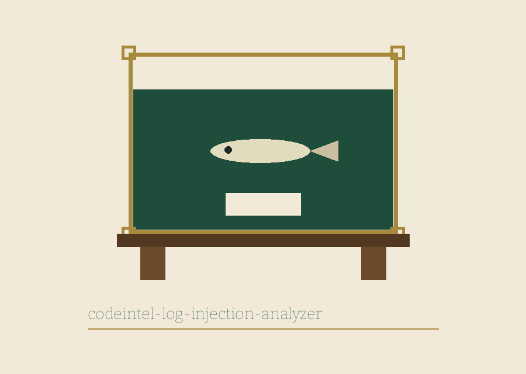

# codeintel-Log-Injection-Analyzer

Title block: the name above is set in BenchNine in bottle green on specimen cream, ruled as a specimen label.  The tank mark is kept small at each heading in this README, at punctuation size, as the theme entry directs.

## Held Apart for Watching 

Scans code for potential log injection vulnerabilities by identifying unsanitized user input that is directly written to log files, allowing attackers to inject malicious log entries. - Focused on Tools for static code analysis, vulnerability scanning, and code quality assurance

## Install 
`git clone https://github.com/ShadowGuardAI/codeintel-log-injection-analyzer`

> **Quarantine notice tied to the bench rail: name flagged.** The install line above writes the organisation name without its hyphen. The repository lives under ShadowGuard-AI, and the corrected address is https://github.com/ShadowGuard-AI/codeintel-log-injection-analyzer. The line is preserved as printed and flagged here. The README gives no step after the clone, and none is added here.

## Usage 
`./codeintel-log-injection-analyzer [params]`

> **Quarantine notice tied to the bench rail: unusable as printed.** The usage line above omits the required file path and cannot be run as shown. The true line is python3 main.py FILEPATH [-l LEVEL] [-o OUTPUT]. Buttons in the kit read Scan This Path, Set the Log Level, Write Results to a File, and Show Help. Headings read Held Apart for Watching, Calls This Scan Can See, Shapes That Are Reported, The Lazy Form Is Left Alone, Not Scanned Is Not Clean, and Findings by File and Line.

## Parameters 
- `-h`: Show help message and exit
- `-l`: No description provided
- `-o`: Path to the output file for results.

> **Quarantine notice tied to the bench rail: A Logger Under Another Name Is Not Seen.** A call counts as a log call only when the receiver is the name logging or the name logger and the method is one of info, error, warning, debug, or critical. A logger held under a different name is not seen, and a logger reached through self.logger is not seen. The parameter list above gives only the short forms, gives -l no description, and omits the positional path in full, although the parser gives both long forms, five permitted levels, and an INFO default. The file is parsed into a syntax tree and the scan walks that tree; it is not a line by line text search. A directory scan reads only files that end in .py, while a single file given directly is attempted whatever its ending is.

> **Quarantine notice tied to the bench rail: Results Are Appended, Never Cleared.** If an output file is named, findings are appended to it, opened in append mode for each finding, and it is never cleared first. A second run at the same path adds its findings below the first run findings. A file that cannot be read, decoded, or parsed is listed as not scanned, and a run with a failed file exits 1, as does a run with findings and a path that does not exist. A run with neither finishes without an exit call and ends at 0.

## License 
Copyright (c) ShadowGuardAI

> **Quarantine notice tied to the bench rail: closing line counted.** The closing line above is the second use of the unhyphenated form in the file. No licence is named in the README and no terms are given. The absence is recorded and nothing is added.
